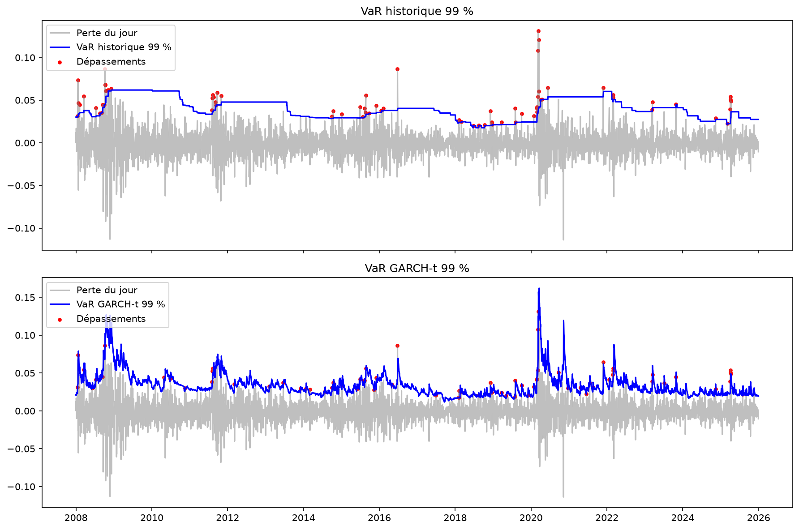

# Market Risk Modeling

Projet personnel en Python sur la mesure du risque de marché. J'ai estimé la VaR et l'Expected Shortfall d'un portefeuille de 5 actions du CAC 40 (TotalEnergies, BNP Paribas, LVMH, Airbus, Sanofi) entre 2005 et 2025, avec plusieurs méthodes, puis j'ai vérifié lesquelles fonctionnent vraiment grâce à un backtest.

Le projet s'appuie sur le cours de Market Risk de M. Garcin (ESILV).

## La question de départ

Quelle méthode de calcul de la VaR donne des prévisions fiables, en période calme comme en période de crise ?

## Ce que j'ai fait

1. **Données (notebook 01)** : téléchargement des prix avec yfinance, calcul des pertes du portefeuille équipondéré. Les rendements ne sont pas gaussiens : queues épaisses (kurtosis de 7,8), asymétrie négative et volatilité qui varie beaucoup dans le temps (de 9 % à 67 % par an).

2. **VaR et ES classiques (notebook 02)** : méthodes historique, gaussienne et KDE. La VaR gaussienne sous-estime le risque à 99 % (3,3 % contre 4,2 % pour l'historique).

3. **GARCH (notebook 03)** : modèle de volatilité conditionnelle, avec une loi normale puis une loi de Student. La volatilité est très persistante (a + b ≈ 0,98) et la version Student colle mieux aux données.

4. **Valeurs extrêmes (notebook 04)** : estimateurs de Hill et de Pickands pour mesurer l'épaisseur de la queue (ξ ≈ 0,32 avec Hill). Cela permet d'estimer des pertes très rares, au-delà de la pire perte observée.

5. **Backtest (notebook 05)** : chaque jour de 2008 à 2025, je calcule la VaR avec uniquement les 500 jours précédents, puis je regarde si la perte du lendemain la dépasse. Je teste ensuite les résultats avec les tests de Kupiec (bon nombre de dépassements ?) et de Christoffersen (dépassements indépendants ?), et avec les zones de Bâle. J'ai ajouté à la fin une méthode supplémentaire, la FHS (simulation historique filtrée).

## Résultat principal

Backtest de la VaR 99 % sur 4 605 jours (46 dépassements attendus) :

| Méthode | Dépassements | Kupiec | Christoffersen | Temps en zone rouge |
|---|---|---|---|---|
| Gaussienne | 105 | rejeté | rejeté | 22 % |
| Historique | 73 | rejeté | rejeté | 9 % |
| KDE | 63 | rejeté | rejeté | 7 % |
| EVT | 68 | rejeté | rejeté | 10 % |
| GARCH normal | 91 | rejeté | ok | 6 % |
| GARCH Student | 74 | rejeté | ok | 2 % |
| FHS | 60 | rejeté de justesse | ok | presque jamais |



## Ce que j'en retiens

- La loi normale sous-estime clairement les pertes extrêmes.
- Les méthodes historique, KDE et EVT ont une queue réaliste mais réagissent trop lentement : leurs erreurs s'enchaînent au début des crises (2008, 2011, Covid).
- Le GARCH réagit vite aux crises, mais la loi de Student sous-estime un peu la queue des pertes.
- La FHS combine les deux (volatilité du GARCH et vrais chocs passés) et c'est la méthode la plus fiable : 60 dépassements, indépendants, et la meilleure en période de crise.

Conclusion : une bonne VaR doit à la fois réagir aux changements de volatilité et avoir une queue épaisse.

## Tester sur votre propre portefeuille

Le notebook `06_Var&ES_Demain.ipynb` applique la FHS à n'importe quel portefeuille d'actions : vous entrez vos actions (symboles Yahoo Finance, par exemple `BNP.PA`) et les montants investis, et il calcule la VaR et l'Expected Shortfall pour le lendemain, en % et en euros.

Il s'ouvre directement dans Google Colab, sans rien installer :

[](https://colab.research.google.com/github/kavinthanrasenthiram/market-risk/blob/master/notebooks/06_Var&ES_Demain.ipynb)

Modifiez la liste des actions dans la section 1, puis lancez toutes les cellules (menu *Exécution*, puis *Tout exécuter*).

## Limites et suites possibles

- En période très calme, les méthodes basées sur le GARCH sous-estiment un peu le risque.
- Je n'ai backtesté que la VaR, pas l'Expected Shortfall.
- On pourrait vérifier la règle de la racine du temps (VaR à 10 jours) avec l'exposant de Hurst.

## Lancer le projet

```
git clone https://github.com/kavinthanrasenthiram/market-risk.git
cd market-risk
python -m venv .venv
.venv\Scripts\activate
pip install -r requirements.txt
mkdir data
```

Puis lancer les notebooks dans l'ordre, de 01 à 06.

## Organisation

- `src/` : les fonctions (données, VaR/ES, GARCH, EVT, backtest)
- `notebooks/` : un notebook par partie, avec les résultats et les explications (le 06 calcule la VaR de demain pour un portefeuille au choix)
- `figures/` : les graphiques

## Références

Cours Market Risk (M. Garcin, ESILV) ; Kupiec (1995) et Christoffersen (1998) pour les tests de backtesting ; Hill (1975) et Pickands (1975) pour les valeurs extrêmes ; Barone-Adesi et al. (1999) pour la FHS.